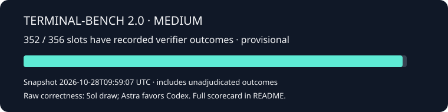
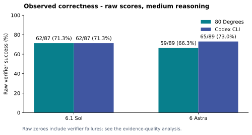
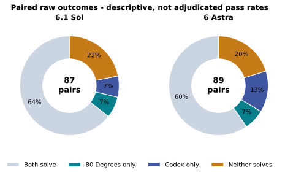
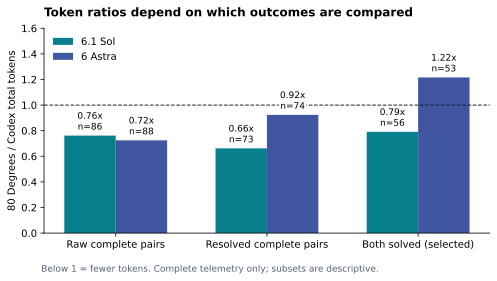
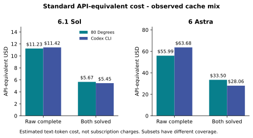
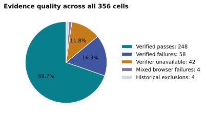

<div align="center">

# 80 Degrees · Benchmarks

**Evidence you can inspect. Comparisons you can reproduce.**

[Harness source](https://github.com/aniasusual/crbn) · [Methodology](docs/METHODOLOGY.md) · [Run a comparison](docs/RUNNING.md) · [Contribute evidence](CONTRIBUTING.md)

</div>

This repository holds evaluation protocols, sanitized results, reports and lessons
from comparing **80 Degrees** with other coding agents through
[Harbor](https://github.com/harbor-framework/harbor). The application and adapter
implementation belong in **crbn**; this repository owns the evidence and study tools.

## Completed benchmark scorecard

| Question | Required evidence | Current conclusion |
|---|---|---|
| **A · More tasks solved** | Same model and effort; paired verifier outcomes; uncertainty | **Observed result: Sol draw; Astra favors Codex.** Raw counts are 62 vs 62 and 59 vs 65. The superiority test does not support an 80 Degrees win. |
| **B · Comparable correctness, fewer tokens** | Correctness noninferiority first, then complete paired token accounting | **80 Degrees uses fewer measured tokens:** 23.8% / 27.5% lower on complete raw pairs. **The combined equal-correctness claim does not pass** the predeclared test. |
| **B · Lower modeled token cost** | Official prices applied to recorded input, cache and output usage | **80 Degrees has lower Standard API-equivalent totals on raw complete pairs:** 1.6% / 12.1% lower. These are estimates, not subscription charges; both-solved estimates favor Codex. |



Execution completed on 27 October 2026 at 17:18 UTC. The analysis, dated
28 October 2026, covers **352 scored cells and four historical exclusions**.

### Reports and evidence

- [Final analysis and limitations](public/studies/october-2026/RESULTS.md)
- [Task-level CSV](public/studies/october-2026/task-results.csv), [analysis JSON](public/studies/october-2026/analysis.json), [attempt accounting](public/studies/october-2026/attempts.json), [provenance and redaction](public/studies/october-2026/provenance.json)
- [API-equivalent cost calculation](public/studies/october-2026/COSTS.md) and [numeric estimates](public/studies/october-2026/api-equivalent-costs.json)

| Medium reasoning | Raw paired success: 80 Degrees / Codex | Raw token reduction* | Correctness lower bound** |
|---|---:|---:|---:|
| 6.1 Sol | 62/87 / 62/87 (71.3% / 71.3%) | 23.8% (86 complete pairs) | -11.84 percentage points |
| 6 Astra | 59/89 / 65/89 (66.3% / 73.0%) | 27.5% (88 complete pairs) | -19.85 percentage points |

\* Input plus output, cached input counted once. Complete scored pairs only;
failed-attempt consumption and missing telemetry are not included in these ratios.
\** Conservative 95% one-sided bound for 80 Degrees minus Codex. The predeclared
noninferiority requirement is a lower bound above **-5 points**. Neither passes.
Equal observed success does not prove equivalence; failure of noninferiority does
not by itself prove inferiority. Exact McNemar Holm-adjusted p-values are 1.0000
and 0.4758, respectively.





### Cost at official API prices

| Standard API-equivalent USD | 80 Degrees | Codex | Observed difference |
|---|---:|---:|---:|
| Sol, 86 raw complete pairs | $11.23 | $11.42 | 80 Degrees 1.6% lower |
| Astra, 88 raw complete pairs | $55.99 | $63.68 | 80 Degrees 12.1% lower |
| Sol, 56 both-solved pairs | $5.67 | $5.45 | 80 Degrees 3.9% higher |
| Astra, 53 both-solved pairs | $33.50 | $28.06 | 80 Degrees 19.4% higher |



Prices verified 28 October 2026 from [official OpenAI pricing](https://developers.openai.com/api/docs/pricing).
Calculation uses recorded uncached input, cached input and output with Standard
rates. No cache writes or long-context premium are applicable to the audited usage.
The same prices are applied to both arms. This excludes missing telemetry, retries,
tools, tax and subscription fees. Raw cost-ratio 95% intervals include 1 for both
models. A lower observed modeled total is not proof of equal-correctness cost
superiority; the both-solved subset is also outcome-selected.

On tasks **both harnesses solve**, Sol uses 20.9% fewer tokens, but Astra uses
**21.6% more**. These selected subsets are descriptive. They are not evidence of
comparable overall correctness. Two-sided 95% bootstrap intervals for the raw
token ratios include 1 for both models; detailed bounds are in the reports.



See [Final analysis and limitations](public/studies/october-2026/RESULTS.md) for
the outcome classifications, exclusions and sensitivity analyses.

## One runner, explicit comparisons

| Harness | Integration | Evidence status |
|---|---|---|
| 80 Degrees | Frozen native engine adapter in crbn | Available-evidence analysis complete; medium only |
| Codex CLI | Pinned CLI adapter in crbn | Available-evidence analysis complete; version 0.163.0 |
| Claude Code | Version-checked portable CLI profile | Experimental; no scored validation here |
| Cursor Agent | Version-checked portable CLI profile | Experimental; effort mapping must be verified |
| Google Antigravity CLI | Version-checked portable CLI profile | Experimental; no scored validation here |
| Your harness | Harbor `import_path` or portable CLI profile | Contributor must validate identity and usage |

Different products need their own supported credentials. A Codex subscription
does not authenticate competing services. A provider such as DeepSeek is not a
harness: record both the model/provider and the agent software. Matching a label
such as “medium” across providers does not prove equal inference settings.

## Get started

See [the complete setup](docs/RUNNING.md). Preparing a study is free of model calls:

```bash
python3 tooling/study.py prepare examples/study.json --output private/my-study
# After replacing placeholders and reviewing the generated manifest/configs:
python3 tooling/study.py run --output private/my-study
```

The runner reserves each attempt durably before launch, runs serially, never
reruns completed jobs and stops on errors. Retries require explicit resumption
and remain capped at three total launches per cell. Keep the same study directory.
The existing October controller and its historical ledger remain separate and
private; this new runner does not migrate or restart them.

## Repository map

```text
docs/          Methodology, setup, publication rules
examples/      Editable study and competitor profiles (no credentials)
tooling/       Durable runner, safe snapshot export, publication audit
tests/         Offline validation; no model usage
public/        Reviewed, sanitized evidence and reproducible charts
```

Raw transcripts, credentials, local runtime bundles, private ledgers and task
checkouts are excluded by default. `.gitignore` is not a sanitizer: use the
publication audit and review every staged file before sharing. The live study's
raw evidence is retained locally for audit, not automatically published.

## Participate

Follow [CONTRIBUTING.md](CONTRIBUTING.md) to submit a reproducible study, adapter
validation or a documented limitation. Community results remain attributed to
their authors until reviewed; submitting a result does not endorse either claim.

No license is granted here for third-party datasets, models, CLIs or transcripts.
Check their terms before redistributing artifacts. This repository is an
independent evaluation project and is not endorsed by the compared vendors.
